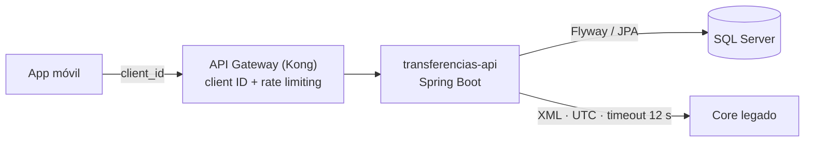
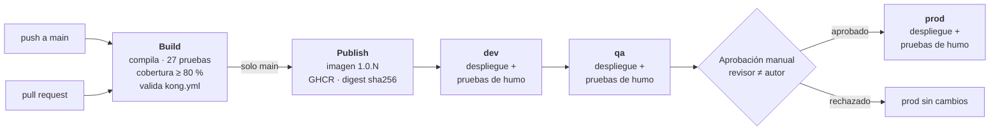

# transferencias-api · Banco Izalco Digital

API para que la app móvil **registre y consulte transferencias interbancarias**, con una plataforma de entrega
que **impide desplegar a producción sin controles**.

[](https://github.com/marvin097/transferencias-api/actions/workflows/ci-cd.yml)

**Stack:** Java 21 · Spring Boot 4.1 · SQL Server 2022 · Flyway · Kong 3.9 (API Gateway) · Docker · GitHub Actions

---

## 1. Cómo levantar la API (un solo comando)

**Requisitos:** Docker Desktop abierto, Java 21 y una terminal bash (Linux, macOS o WSL en Windows).

```bash
git clone https://github.com/marvin097/transferencias-api.git
cd transferencias-api
./scripts/levantar-local.sh
```

El script crea un archivo `.env` con **claves aleatorias locales** (si no existe), compila, ejecuta las 27 pruebas,
levanta los contenedores y al final muestra la URL de Swagger y el `client_id` a usar.

<details>
<summary>Hacerlo paso a paso (sin el script)</summary>

```bash
cp .env.example .env            # plantilla con valores ficticios; .env nunca se sube a git
./mvnw clean verify             # compila, 27 pruebas y cobertura mínima de 80 %
docker compose up -d --build    # API + gateway + SQL Server + core simulado
```
</details>

### Probar desde el navegador

1. Abrir **http://localhost:8000/swagger-ui.html**
2. Botón **Authorize** → escribir el `client_id` (valor de `CLIENT_ID_APP_MOVIL` en `.env`).
3. `POST /transferencias` → **Try it out** → **Execute**.

El core simulado responde según el **monto**, para poder probar cada caso:

| Monto | Core responde | La API devuelve |
|---|---|---|
| cualquier otro (ej. 150.75) | `00` aprobada | `201` APROBADA |
| `51.00` | `51` saldo insuficiente | `422` SALDO_INSUFICIENTE |
| `62.00` | `62` cuenta bloqueada | `422` CUENTA_BLOQUEADA |
| `91.00` | `91` no disponible | `503` CORE_NO_DISPONIBLE (reintentable con la misma llave) |
| `99.99` | tarda 15 s | `202` EN_VERIFICACION a los ~12 s (no se reenvía) |

También hay pruebas listas en [`http/transferencias.http`](http/transferencias.http) (extensión *REST Client* de VS Code).

| Comando | Para qué |
|---|---|
| `docker compose ps` | Ver el estado de los contenedores |
| `docker compose logs -f api` | Ver los logs de la API |
| `docker compose down` | Apagar todo (conserva la base de datos) |
| `docker compose down -v` | Apagar y borrar la base de datos |

---

## 2. Arquitectura



| Endpoint | Descripción |
|---|---|
| `POST /transferencias` | Registra una transferencia. Header `X-Idempotency-Key` obligatorio. |
| `GET /transferencias/{id}` | Consulta una transferencia (cuentas enmascaradas). |

Contrato: [`openapi.yaml`](src/main/resources/static/openapi.yaml) (OpenAPI 3.0, escrito a mano, *contract-first*).

---

## 3. Decisiones de diseño

| Tema | Decisión | Por qué |
|---|---|---|
| Tecnología | Spring Boot en contenedores | Una de las dos opciones permitidas; portable a cualquier nube o Kubernetes. |
| Contrato | OpenAPI escrito a mano y servido en Swagger UI | El contrato se acuerda con la app antes del código; Swagger muestra exactamente ese contrato. |
| Integración con el core | XML generado con StAX (JDK), parser sin DTD ni entidades externas | Sin dependencias extra y protegido contra XXE. |
| Fecha | `fechaSolicitud` con zona horaria obligatoria; se convierte a UTC `yyyyMMddHHmmss` | Evita el error del INC-2026-118 (14:32 −06:00 → `20261001203210`). |
| Glosa | Mayúsculas, **sin tildes**, espacios normalizados, máx. 30 caracteres | El core legado no garantiza soporte de acentos. |
| Idempotencia | Llave única en BD + huella SHA-256 de los 7 campos de negocio | Misma llave y contenido: devuelve el resultado guardado. Misma llave y otro contenido: `409`. La restricción `UNIQUE` resuelve la concurrencia. |
| Reintentos al core | **Ninguno automático** | Reintentar una transferencia a ciegas la puede duplicar. Solo se reenvía cuando hay certeza de que el core no la procesó (`91` o conexión rechazada). |
| Resultado incierto | Si el core no responde a tiempo: `202 EN_VERIFICACION` | Un `504` hace que la app reintente; un `202` le dice que consulte el estado. |
| Errores | RFC 9457 (`application/problem+json`) con campo `codigo` estable | La app decide por el `codigo`, no por el texto. |
| Saldo | La API **no** valida saldos | El core es la única fuente de verdad del saldo; la API solo traduce sus respuestas. |
| Base de datos | SQL Server con un login propio para la API; esquema versionado con Flyway | La API nunca usa `sa`; cada ambiente tiene exactamente las mismas migraciones. |
| Pruebas | H2 en memoria (modo SQL Server) + core simulado por HTTP real | Pruebas rápidas sin Docker, que cubren timeouts y caídas reales. |
| Políticas | Kong declarativo (`kong/kong.yml`), sin API de administración | Equivalente a las políticas de API Manager, pero versionadas y revisables en PR. |
| Datos sensibles | Cuentas enmascaradas en las respuestas; nada sensible en los logs | Mínima exposición de datos del cliente. |

---

## 4. Pipeline de CI/CD



Archivos: [`ci-cd.yml`](.github/workflows/ci-cd.yml) y [`deploy.yml`](.github/workflows/deploy.yml) (un único despliegue reutilizado en los tres ambientes).

| Requisito de la prueba | Cómo se cumple |
|---|---|
| Compila, prueba y falla si no hay cobertura | `./mvnw clean verify` con JaCoCo `check` al 80 % de líneas, **fijo en el `pom.xml`** (no es un parámetro que se pueda apagar). |
| Artefacto versionado, el mismo en dev, qa y prod | Versión de release `1.0.<n>` (nunca SNAPSHOT). La imagen se construye **una vez** y se despliega por **digest `sha256`**. |
| Identidad de servicio | Todo usa el `GITHUB_TOKEN` efímero del pipeline. No hay usuarios ni contraseñas personales. |
| Políticas como código | `kong/kong.yml`: client ID (`401` si falta o no es válido) y 20 solicitudes por minuto por aplicación (`429`). Se validan en el build y se prueban en cada ambiente. |
| Aprobación manual; quien aprueba no es el autor | Ambiente `prod` con revisor obligatorio, **prevent self-review** y despliegue solo desde `main`. |

Cada despliegue ejecuta pruebas de humo **a través del gateway**: 401 sin `client_id`, 201 aprobada, reintento
idempotente, 422 traducido, 429 por rate limiting y, en prod, Swagger desactivado. El resumen de la ejecución
registra la versión, la imagen exacta, quién inició el cambio y la identidad que desplegó.

**Configuración de los ambientes como código:** [`scripts/configurar-github.sh`](scripts/configurar-github.sh) crea
`dev`, `qa` y `prod` con sus reglas y genera secretos aleatorios distintos por ambiente.

---

## 5. Configuración y secretos

| Dónde | Qué contiene |
|---|---|
| `application.yml` | Valores comunes y la configuración local (H2). |
| `application-{dev,qa,prod}.yml` | Diferencias por ambiente. URL del core, usuarios y contraseñas solo como `${VARIABLE}` **sin valor por defecto**: si falta una, la API no arranca. |
| `.env` (local, ignorado por git) | Claves locales. Plantilla: [`.env.example`](.env.example). |
| Secretos de ambiente en GitHub | Claves de dev, qa y prod, distintas en cada uno. |

En prod además se desactivan Swagger UI y `/v3/api-docs`, y los logs bajan a `WARN`.

---

## 6. Supuestos y alcance

Ante dudas de alcance, se decidió, se documentó y se continuó:

- **Respuesta del core:** el enunciado no la muestra; se asumió `<TransferenciaResponse><Codigo>..</Codigo><Referencia>..</Referencia></TransferenciaResponse>`.
- **Códigos desconocidos** del core: se tratan como rechazo y se responde `502 RESPUESTA_CORE_INVALIDA`.
- **Ambientes simulados:** no hay infraestructura real; cada despliegue levanta la imagen publicada con SQL Server y el core simulado dentro del runner. En una instalación real, el mismo paso desplegaría la misma imagen (por digest) en Kubernetes o Azure Container Apps.
- **Gateway:** se usó Kong como equivalente de API Manager. El client ID es una sola clave por aplicación; en producción se recomendaría OAuth 2.0 *client credentials*.
- **Revisión de cambios:** `CODEOWNERS` marca como sensibles el pipeline, el `pom.xml` y la configuración de prod; la protección de rama que lo hace obligatorio se activa en la configuración del repositorio.

---

## 7. Post-mortem INC-2026-118

[`docs/post-mortem-INC-2026-118.md`](docs/post-mortem-INC-2026-118.md) ([PDF](docs/post-mortem-INC-2026-118.pdf)):
hallazgos, causa raíz, impacto, corrección inmediata y los controles de este repositorio que evitan que se repita.

---

## 8. Estructura del repositorio

```
.github/workflows/      Pipeline CI/CD y despliegue reutilizable
docker/                 Script de base de datos y core simulado (WireMock)
docs/                   Post-mortem
http/                   Pruebas manuales (REST Client)
kong/kong.yml           Políticas de la API como código
scripts/                Levantar en local y configurar ambientes de GitHub
src/main/java/...       api · servicio · dominio · core
src/main/resources/     Configuración por ambiente, migraciones Flyway y contrato OpenAPI
src/test/java/...       27 pruebas (unitarias y de punta a punta con core simulado)
```

## 9. Mejoras siguientes

- Proceso de **conciliación** que resuelva las transferencias `EN_VERIFICACION` consultando al core.
- OAuth 2.0 en el gateway, con llaves de idempotencia por cliente.
- Escaneo de vulnerabilidades de la imagen (por ejemplo, Trivy) y firma de imágenes en el pipeline.
- Métricas y alertas (p95 de latencia hacia el core, tasa de 5xx).
